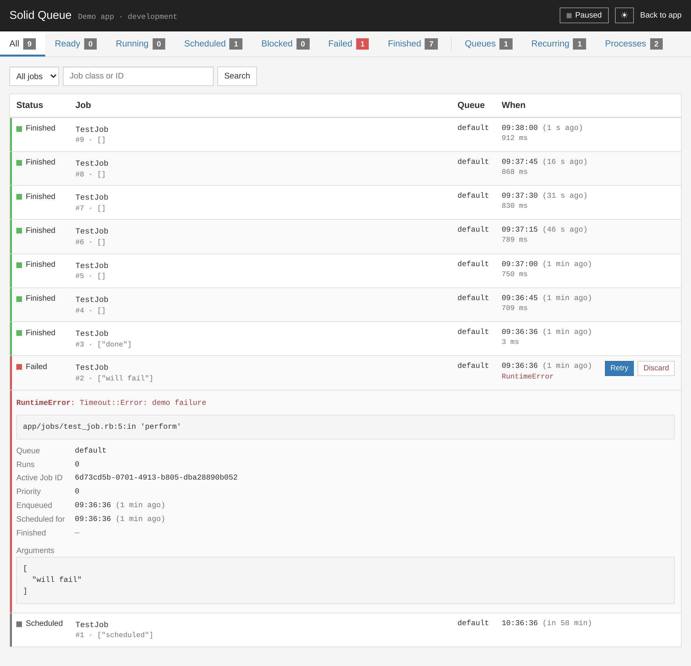
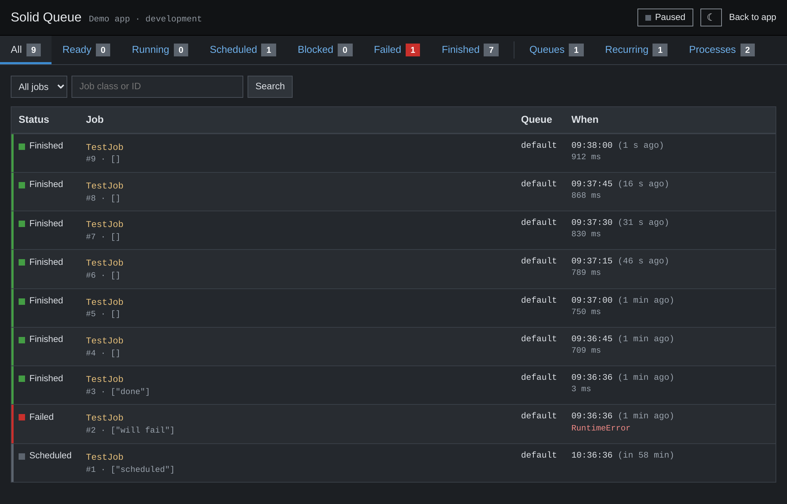
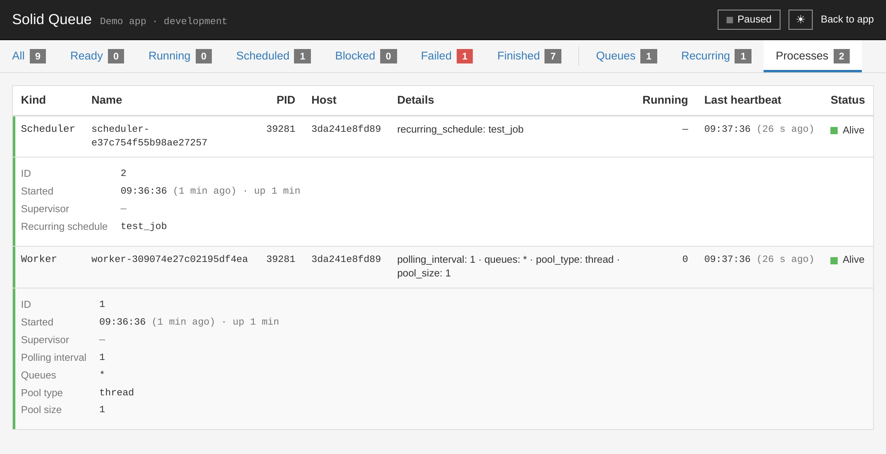
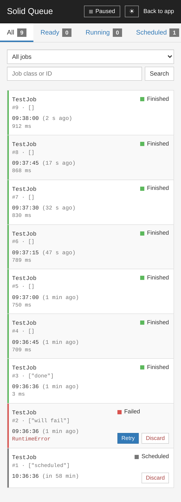

# Solid Queue Board

A small, self-contained dashboard for [Solid Queue](https://github.com/rails/solid_queue).

- One menu row: job states (all, ready, running, scheduled, blocked, failed, finished) with live counts, then queues, recurring tasks and processes.
- Plain tables in a Bootstrap 3 look with square corners, light and dark theme (follows the system, or pick one).
- Auto-refresh by polling: 3, 6, 12 or 24 seconds, or paused (6 by default). It pauses while the tab is hidden, while you type in a field and while you select text.
- Jobs: filter by job class, search by class or ID, sort by job, queue or time (click a column header). Filters and sorting use [Ransack](https://github.com/activerecord-hackery/ransack).
- Click a job or a process to expand it: arguments, error and backtrace for jobs; supervisor, metadata and running jobs for processes.
- Actions: retry or discard failed jobs, retry all failed jobs, discard ready, scheduled or blocked jobs, pause and resume queues, run a recurring task now.
- No front-end dependencies to install or import: CSS and JavaScript ship inside the gem and are inlined in the page. No asset pipeline, no CDN, no web fonts. Works with Sprockets, Propshaft or neither.
- English, Italian, German, Spanish, French, Portuguese, Simplified Chinese, Japanese and Korean translations.

## Screenshots



| Dark theme | Processes | Mobile |
|---|---|---|
|  |  |  |

## Requirements

- Ruby 3.2+
- Rails 7.1+
- Solid Queue 1.0+
- Ransack 4.0+ (installed with the gem)

## Installation

```ruby
# Gemfile
gem "solid_queue_board"
```

```ruby
# config/routes.rb
mount SolidQueueBoard::Engine, at: "/jobs"
```

## Access control

The dashboard is **closed outside development and test** until you configure it. Create an initializer:

```ruby
# config/initializers/solid_queue_board.rb
SolidQueueBoard.configure do |config|
  # Inherit from your controller to reuse its authentication (before_actions, current_user, ...).
  config.base_controller_class = "ApplicationController"

  # Called with the controller before every action. Return true to allow access.
  config.authorize = ->(controller) { controller.current_user&.admin? }
end
```

With Devise you can also protect the mount point itself:

```ruby
authenticate :user, ->(user) { user.admin? } do
  mount SolidQueueBoard::Engine, at: "/jobs"
end
```

If you protect the route this way, `config.authorize = ->(_) { true }` is enough.

## Configuration

| Option | Default | Description |
|---|---|---|
| `base_controller_class` | `"ActionController::Base"` | Controller the dashboard inherits from. |
| `authorize` | open in development and test only | Lambda receiving the controller, returns true to allow access. |
| `title` | host app name | Name shown in the top bar and in the page title. |
| `back_url` | `"/"` | Link back to the host app in the top bar. `nil` hides it. |
| `per_page` | `50` | Rows per page in the jobs table. |
| `poll_intervals` | `[3, 6, 12, 24, 0]` | Refresh choices in seconds, in click order. `0` means paused. |
| `default_poll_interval` | `6` | Refresh interval used until the user picks another one. |

The chosen theme and refresh interval are stored per browser in `localStorage`.

## How auto-refresh works

The page polls its own URL with the `X-SQB-Partial` header. The server then renders only the menu and the content, without the layout, and the script swaps them in. Expanded job and process rows stay open across refreshes. Rows whose state changed are briefly highlighted. If the session expires, the refresh stops with an error message instead of loading the login page inside the dashboard.

Each refresh runs a handful of `COUNT` queries (one per job state plus queues, recurring tasks and processes) and one page of jobs. The jobs page also loads the list of job classes for the filter menu (`SELECT DISTINCT class_name`, served by Solid Queue's index on that column).

## Content Security Policy

Inline `<style>` and `<script>` tags carry the request nonce when your app configures one (`content_security_policy_nonce`). No inline event handlers or `style` attributes are used.

## Translations

English, Italian, German, Spanish, French, Portuguese, Simplified Chinese, Japanese and Korean are included (`en`, `it`, `de`, `es`, `fr`, `pt`, `zh-CN`, `ja`, `ko`). The page follows `I18n.locale`; if your app sets `config.i18n.available_locales`, add the ones you want there. To add a language, copy `config/locales/en.yml` into your app as `config/locales/solid_queue_board.<locale>.yml` and translate the `solid_queue_board` keys.

## Development

```bash
bundle install
bundle exec rake test
```

Tests run against an in-memory SQLite database with the Solid Queue schema loaded.

To try the dashboard on a demo app (SQLite, an in-process worker and a recurring job every 15 seconds):

```bash
bundle exec rake demo   # http://localhost:3000/jobs, PORT=4000 to change
```

## License

MIT, see [LICENSE.txt](LICENSE.txt).
